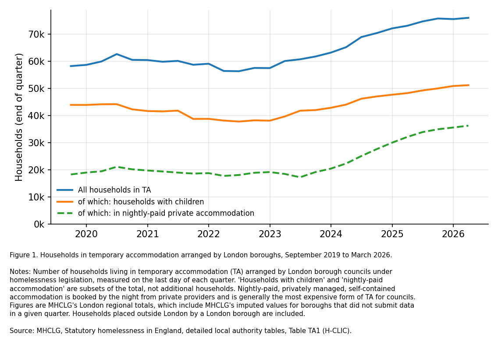
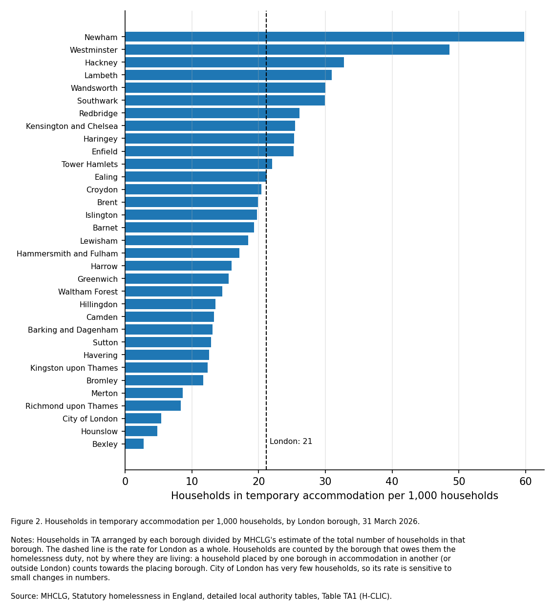
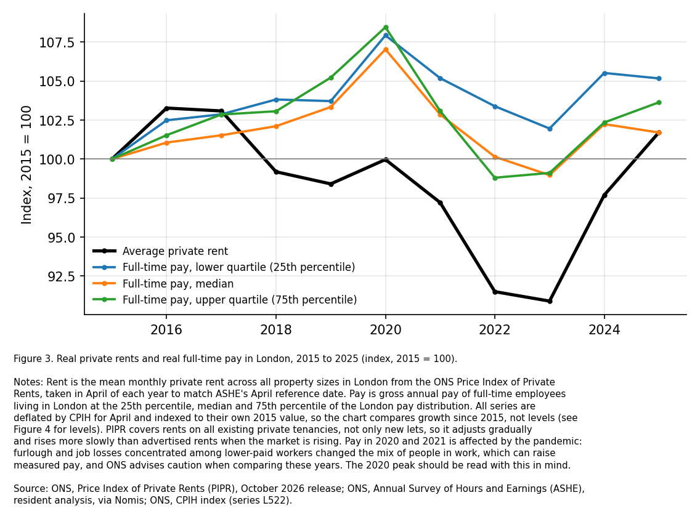
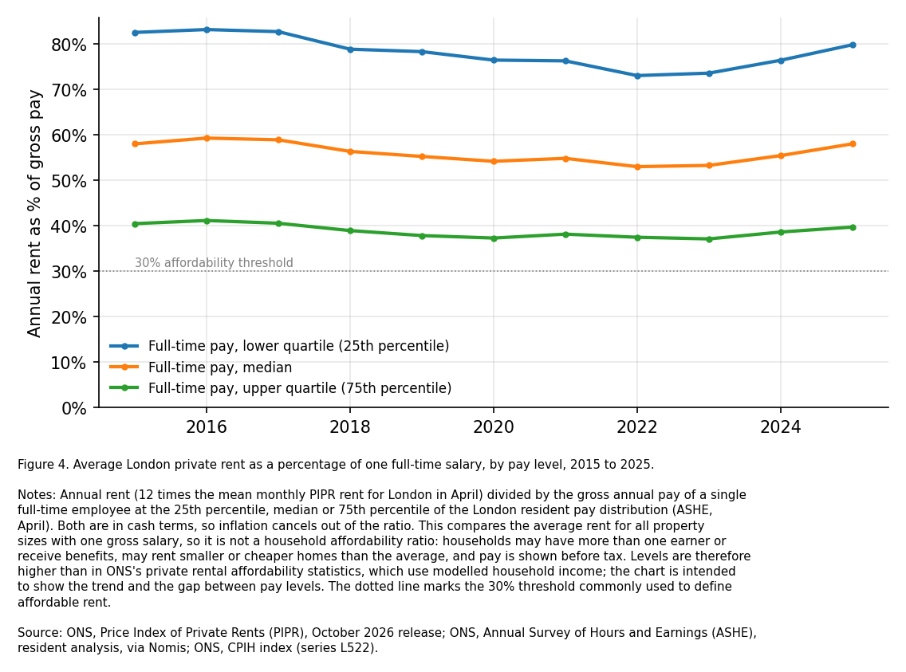
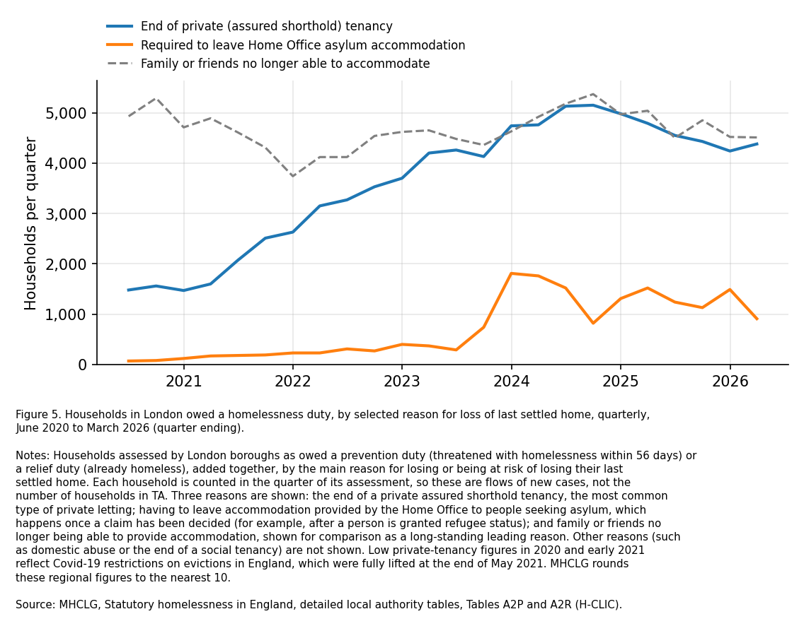
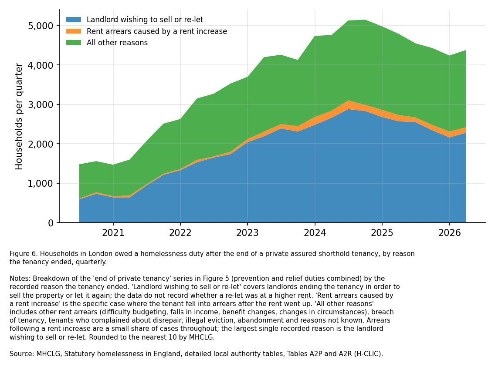

# Rents, pay and temporary accommodation in London

A short personal research project using official statistics to look at one question: **why has the number of London households in temporary accommodation risen so sharply since 2023?**

The chain examined is:

> private rents rise faster than low pay → private tenancies end → households cannot find another home they can afford → councils place them in temporary accommodation (TA)

## Main findings

1. **TA has risen by about 30% since 2019, almost all of it since 2023.** London boroughs had 58,230 households in TA in September 2019 and 76,020 in March 2026. The total was roughly flat until 2022. Households in nightly-paid accommodation, usually the most expensive type for councils, doubled from about 18,000 to about 36,000 (Figure 1).
2. **Rates vary a lot between boroughs** (Figure 2), so a London-wide figure hides very different pressures on individual councils.
3. **Rents have pulled away from pay again since 2023.** Real private rents fell by about 9% between 2020 and 2023 as inflation outpaced them, then rose by about 12% between 2023 and 2025 (Figure 3). The average London rent was equal to 83% of a lower-quartile full-time salary in 2015, fell to 73% in 2022 and was back to 80% in 2025. For median pay the figures are 58%, 53% and 58% (Figure 4).
4. **Losing a private tenancy has become a much more common route into homelessness.** Households owed a homelessness duty after the end of a private assured shorthold tenancy rose from about 1,500 a quarter in 2021 to 4,000 to 5,000 a quarter from 2024 (Figure 5). People leaving Home Office asylum accommodation added a sharp spike, peaking at about 1,800 a quarter in early 2024.
5. **The mechanism looks like being unable to re-rent, not falling behind on rent.** Among private tenancies that ended, the largest recorded reason is the landlord wishing to sell or re-let. Arrears that followed a rent increase account for only about 50 to 200 cases a quarter (Figure 6). Rising rents seem to matter mainly because households who have to move cannot afford what is on the market, rather than because they fall into arrears where they are.

These are descriptive patterns, not causal estimates. See the caveats below.

## Figures

Each figure has its full notes and sources printed underneath it.

### 1. Temporary accommodation in London over time


### 2. Temporary accommodation rate by borough, March 2026


### 3. Real rents and real pay since 2015


### 4. Rent as a share of one full-time salary


### 5. Reasons for homelessness


### 6. Why private tenancies ended


## Data

All data are public official statistics.

| Source | Used for |
|---|---|
| MHCLG, [Statutory homelessness in England](https://www.gov.uk/government/collections/homelessness-statistics), detailed local authority tables (H-CLIC), quarterly 2019 Q3 to 2026 Q1. Tables TA1, A2P and A2R | Households in TA, reasons for homelessness |
| ONS, [Price Index of Private Rents](https://www.ons.gov.uk/economy/inflationandpriceindices/datasets/priceindexofprivaterentsukmonthlypricestatistics) (PIPR), October 2026 release | Average London private rent |
| ONS, Annual Survey of Hours and Earnings (ASHE), resident analysis, via [Nomis](https://www.nomisweb.co.uk/) (dataset NM_30_1) | Full-time gross annual pay, 25th/50th/75th percentiles |
| ONS, [CPIH index, series L522](https://www.ons.gov.uk/economy/inflationandpriceindices/timeseries/l522/mm23) | Deflating rents and pay |

## Method

- `src/load_ta.py` reads the quarterly MHCLG spreadsheets (whose layouts change between releases) and extracts London and borough TA counts into one tidy quarterly table.
- `src/load_reasons.py` does the same for the reasons-for-homelessness tables, adding the prevention and relief duties together.
- `src/analysis.py` joins rents, pay and CPIH, builds the indices and ratios, and draws the figures with their captions.

Rent and pay are both taken in April, to match ASHE's reference date. Real series are deflated by April CPIH.

## Caveats

- Not every borough submits data every quarter. London totals use MHCLG's imputed figures for missing boroughs.
- Borough TA rates divide by the latest MHCLG household estimates.
- TA is counted by the council that placed the household, not where the household lives. Households placed outside London by a London borough count towards that borough.
- PIPR covers all existing private tenancies, not only new lets, so it rises more slowly than advertised rents when the market is rising. This probably understates the rents faced by households who have to move.
- Rent as a share of one gross salary is not a household affordability ratio: households may have two earners, receive benefits or rent cheaper homes than the average.
- ASHE pay in 2020 and 2021 is affected by changes in who was in work during the pandemic. Private tenancy endings in 2020 and early 2021 were held down by the eviction ban.

## Reproducing

Requires Python 3.9+.

```
python -m venv .venv
.venv/bin/pip install -r requirements.txt
.venv/bin/python src/load_ta.py        # slow: parses the quarterly ODS files
.venv/bin/python src/load_reasons.py
.venv/bin/python src/analysis.py       # writes figures/ and data/clean/
```

The raw downloads are in `data/raw/` and the processed tables in `data/clean/`.
